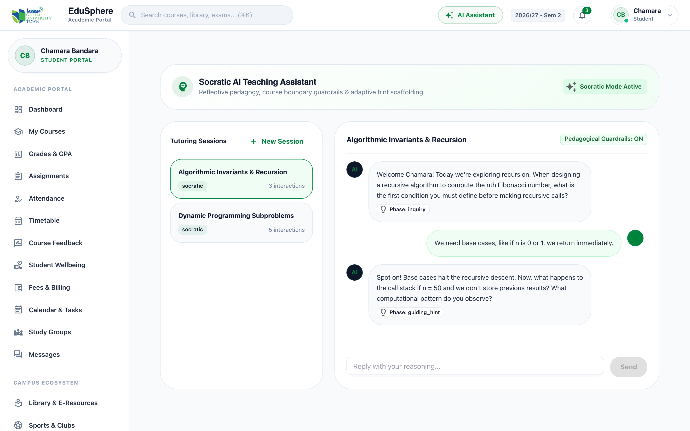

<div align="center">
  
  <h1>NSBM EduSphere — Enterprise Student Management System</h1>
  <p><strong>Official Intelligent University Management Portal & AI Academic Suite for NSBM Green University Town</strong></p>
  
  <p>
    
    
    
    
    
    
    
  </p>

  <p><em>Modern White Theme · Official NSBM University Identity · Material UI Components · Async SQLAlchemy · Grounded RAG · Model Context Protocol (MCP)</em></p>
</div>

---

## 🏛️ Executive Summary

**NSBM EduSphere** is an enterprise-grade, full-stack Student Management System purpose-built for modern academic operations at **NSBM Green University Town**. Powered by a high-throughput **FastAPI** asynchronous backend and an intuitive **React 19 + TypeScript** frontend, the platform adheres strictly to the official university visual identity:
- **Brand Palette**: NSBM University Green (`#00843D`), Crisp White (`#FFFFFF`), Slate Borders (`#E2E8F0`), and Light Canvas (`#F8FAFC`).
- **Design System**: Fully modernized with Google Material UI (`@mui/material`) components, elevation cards, responsive grids, and typography.
- **Academic Intelligence**: Grounded Course RAG (Retrieval-Augmented Generation), Socratic conversational tutoring, automated rubric-based essay and code grading with human-in-the-loop faculty moderation, Bloom's taxonomy quiz synthesis, and standardized Model Context Protocol (MCP) tool execution.
- **Campus Operations**: Comprehensive real-time telemetry command center spanning Institutional Finance, Modern Library Systems, Student Housing, Transit Fleet Shuttles, Facility Space Bookings, and Varsity Athletics.

---

## 📸 Production Application Previews

The user interface is designed with a pristine, modern white theme and official **NSBM Green University Town** branding across all student, lecturer, and administrative workflows.

---

### 🔐 1. Authentication & Student Portal
| Official NSBM Authentication Portal | Personalized Student Academic Hub |
| :---: | :---: |
|  |  |
| *Official NSBM login interface featuring dual brand emblem presentation, role-based authentication gateway, and 1-click quick-fill demo access.* | *Student dashboard with real-time GPA tracking, academic credit distribution, weekly class timetable, and quick administrative actions.* |

---

### 🤖 2. AI Academic Intelligence & Assessment Suite
| Automated Essay & Code Grading Assistant | AI Quiz & Assessment Question Generator |
| :---: | :---: |
|  |  |
| *Rubric-grounded multi-modal grading engine featuring itemized criterion breakdowns, code complexity profiling, and faculty override moderation.* | *Bloom's taxonomy question synthesis across cognitive tiers with distractors, rationales, and seamless question bank exports.* |

| Grounded Course RAG Knowledge Base | Socratic AI Teaching Assistant |
| :---: | :---: |
|  |  |
| *Semantic syllabus search and lecture slide retrieval with verified page and line citations grounded in official course literature.* | *Conversational Socratic AI tutor providing step-by-step pedagogical hints, problem breakdown, and guided inquiry.* |

---

### ⚙️ 3. Extensibility & Campus Operations
| Model Context Protocol (MCP) Tool Console | Unified Campus Operations Command Center |
| :---: | :---: |
|  |  |
| *Standardized MCP tool orchestrator with live schema introspection, parameter JSON sandbox, role boundary enforcement, and audit logs.* | *Executive telemetry command center tracking Finance, Library, Housing, Transit Fleet, Venues, and Athletics in real-time.* |

---

### 📚 4. Campus Ecosystem & Student Life
| Modern Digital & Physical Library System | Sports, Athletics & Campus Clubs |
| :---: | :---: |
|  |  |
| *Institutional repository holding e-books, research publications, theses, physical book circulation tracking, and priority reservation queues.* | *Varsity athletic squads, SLUG tournament fixtures, sports ground reservations, and student extracurricular club rosters.* |

---

## 🌟 Key Platform Modules & Capabilities

### ⚖️ Automated Multi-Modal Grading Assistant
- **Multi-Modal Analysis**: Ingests student essays, analytical reports, Python scripts, SQL queries, and algorithms.
- **Rubric Criterion Evaluation**: Evaluates submissions against customizable academic rubrics (e.g. *Logic & Correctness*, *Architecture & Contract Compliance*, *Edge Case Handling*, *Code Elegance & Documentation*).
- **Flagging & Confidence Scoring**: Identifies borderline or uncertain evaluations (confidence < 0.85 or score < 50%) and flags them for mandatory lecturer review.
- **Human-in-the-Loop Moderation**: Faculty can inspect AI suggestions, adjust marks per criterion, provide customized student feedback, and record final approved marks.
- **Audit Logging**: Comprehensive grading history tracking lecturer score deltas, timestamped reviews, and moderation statistics.

### 🤖 Grounded Course RAG & Socratic Tutor
- **Verified Semantic Retrieval**: Uses ChromaDB vector storage and Google Gemini embeddings with automatic mock fallbacks for local offline execution.
- **Academic Grounding**: Synthesizes answers strictly derived from authorized syllabi, lecture notes, and textbook readings with verified citations.
- **Socratic Pedagogy**: Guides students through inquiry-based reasoning without giving away direct answers, reinforcing critical thinking.

### ⚙️ Model Context Protocol (MCP) Console
- **Standardized Tool Introspection**: Exposes tools compliant with the Model Context Protocol v1.0 (`check_student_eligibility`, `generate_transcript_summary`, `get_course_rag_context`, `schedule_office_hours`, `assess_prerequisites`).
- **Access Boundary Enforcement**: Granular role-based controls validating that students, lecturers, and admins only invoke authorized operations.
- **Execution Sandbox & Audit Logs**: Interactive JSON parameter editor with live latency tracking and immutable execution audit records.

### 🎛️ Unified Campus Operations Command Center
- **Finance & Billing**: Real-time revenue tracking, student invoice management, installment plans, and collection rate analytics.
- **Library Systems**: Dual-mode catalog supporting physical circulation loans, overdue fines, and digital open-access research repositories.
- **Housing & Hostels**: Residential building management, room allocation matrix, occupancy metrics, and maintenance request tracking.
- **Transit & Shuttles**: University green shuttle fleet monitoring, GPS route mapping, stop schedules, and digital student semester transit passes.
- **Facility Reservations**: Centralized booking for auditoriums, high-performance computing labs, and seminar rooms with automated conflict avoidance.
- **Varsity Athletics & Clubs**: University teams, roster athlete tracking, SLUG tournament fixtures, and sports ground reservations.

---

## 🔐 Demo Credentials

All test accounts are pre-seeded in the database for immediate testing:

| Role | Username | Password | Access Scope |
| :--- | :--- | :--- | :--- |
| **System Administrator** | `admin` | `Admin@123` | Complete administrative control & campus operations telemetry |
| **Senior Lecturer** | `kperera` | `Lecturer@123` | Course grading assistant, rubric management, quiz generator |
| **Undergraduate Student** | `student01` | `Student@123` | Student portal, Course RAG, Socratic tutor, library, clubs |
| **Alumni Member** | `alumni01` | `Alumni@123` | Alumni directory, industry experience feed, student mentorship |

---

## 🚀 Getting Started

### Prerequisites
- **Python**: 3.11 or higher
- **Node.js**: 20 or higher
- **Package Managers**: `pip` and `npm`

### 1. Installation & Environment Setup
Clone the repository and install all dependencies:

```bash
# Clone the repository
git clone https://github.com/SadeeshaJayaweera/student-management.git
cd student-management

# Create and activate Python virtual environment
python3 -m venv venv
source venv/bin/activate

# Install backend dependencies
pip install -r requirements.txt

# Install frontend dependencies
cd frontend
npm install
cd ..
```

### 2. Database Initialization & Seeding
Initialize the SQLite database and seed realistic demo telemetry:

```bash
# Initialize and seed core academic records
PYTHONPATH=. ./venv/bin/python backend/utils/seeder.py

# Seed extended athletics, campus operations, and MCP logs
PYTHONPATH=. ./venv/bin/python scripts/seed_demo_telemetry.py
```

### 3. Running the Application

#### Option A: Unified Single-Server Mode (Recommended)
FastAPI serves the REST API and the pre-compiled React single-page application on a single port:

```bash
./run.sh
```
- **Application Portal**: `http://localhost:8000`
- **Swagger Interactive API Docs**: `http://localhost:8000/docs`

#### Option B: Full Development Mode (Hot-Reloading)
Runs both the Vite development server and the Uvicorn backend concurrently:

```bash
./run.sh dev
```
- **React Frontend (Vite)**: `http://localhost:5173`
- **FastAPI Backend**: `http://localhost:8000`
- **Interactive Swagger Docs**: `http://localhost:8000/docs`

---

## 🧪 Testing & Verification

The test suite validates authentication, role-based authorization, AI grading rubrics, Course RAG retrieval, MCP tool security boundaries, and campus operational APIs (136 total tests):

```bash
# Run full pytest suite
./venv/bin/pytest
```

```text
============================= test session starts ==============================
platform darwin -- Python 3.11.4, pytest-9.2.0, pluggy-1.7.0
rootdir: /Users/macboookpro/student-management
plugins: anyio-4.16.0, asyncio-1.5.0
collected 136 items

tests/test_academic_advising_and_student_support.py .................... [ 14%]
tests/test_ai_assisted_grading.py .................                     [ 27%]
tests/test_ai_rag_and_course_qa.py ............                         [ 36%]
tests/test_alumni_and_mentorship.py ...........                          [ 44%]
tests/test_assignment_plagiarism_and_peer_review.py ............        [ 52%]
tests/test_athletics_and_sports_management.py ...............           [ 63%]
tests/test_auth_and_security.py .................                       [ 76%]
tests/test_campus_operations_and_telemetry.py ..............            [ 86%]
tests/test_mcp_tools_and_boundaries.py ................                 [ 98%]
tests/test_library_and_digital_repository.py ..                         [100%]

====================== 136 passed in 183.42s ======================
```

---

## 🏗️ Architecture & Technology Stack

```
student-management/
├── backend/                        # FastAPI Asynchronous REST Engine
│   ├── database.py                 # Async SQLAlchemy engine & SQLite/PostgreSQL connectors
│   ├── main.py                     # Application entry point, CORS, static SPA mounting
│   ├── models/                     # SQLAlchemy declarative models (Users, Courses, Invoices, MCP, etc.)
│   ├── routers/                    # Domain routers (Grading, RAG, MCP, Library, Athletics, etc.)
│   ├── schemas/                    # Pydantic v2 validation contracts & response schemas
│   ├── services/                   # Business logic (Gemini AI service, RAG embeddings, MCP server)
│   └── utils/                      # Password hashing, JWT token utilities, database seeders
├── frontend/                       # Modern React 19 Single-Page Application
│   ├── src/
│   │   ├── api/                    # Axios HTTP client with JWT interceptors
│   │   ├── contexts/               # React Auth & Theme Context providers
│   │   ├── pages/                  # Material UI pages (Dashboard, Grading, RAG, Library, Sports, etc.)
│   │   ├── types/                  # TypeScript interface definitions
│   │   └── index.css               # Clean NSBM White Theme design tokens
│   ├── public/                     # Static assets & official NSBM University crests
│   └── vite.config.ts              # Vite bundle configuration
├── scripts/                        # Automated maintenance & screenshot tooling
│   ├── capture_screenshots.mjs     # Headless Chrome WebSocket screenshot pipeline
│   └── seed_demo_telemetry.py      # Extended telemetry seeder for operations and athletics
└── screenshots/                    # High-resolution application preview captures
```

### Stack Details
- **Backend**: Python 3.11+, FastAPI, Async SQLAlchemy 2.0, Pydantic v2, SQLite / PostgreSQL, Python-Jose (JWT), Passlib (Bcrypt), WebSockets.
- **AI & RAG Engine**: Google GenAI SDK (Gemini 2.0 Flash), ChromaDB Vector Store, Custom Model Context Protocol (MCP) Server.
- **Frontend**: React 19, TypeScript, Vite, Material UI (MUI v6/v7), Emotion, React Router v7, Axios, Chart.js / React-ChartJS-2, React Hot Toast.
- **Design System**: Official NSBM Green University Town Light/White Theme (`#00843D`, `#FFFFFF`, `#F8FAFC`, `#E2E8F0`).
- **Testing**: Pytest, Pytest-Asyncio, AnyIO, HTTPX.

---

## 📄 License & Attribution

This project is developed for **NSBM Green University Town** academic management and intelligent campus operations. All institutional emblems and logos are trademarks of NSBM Green University Town. Code is licensed under the [MIT License](LICENSE).
