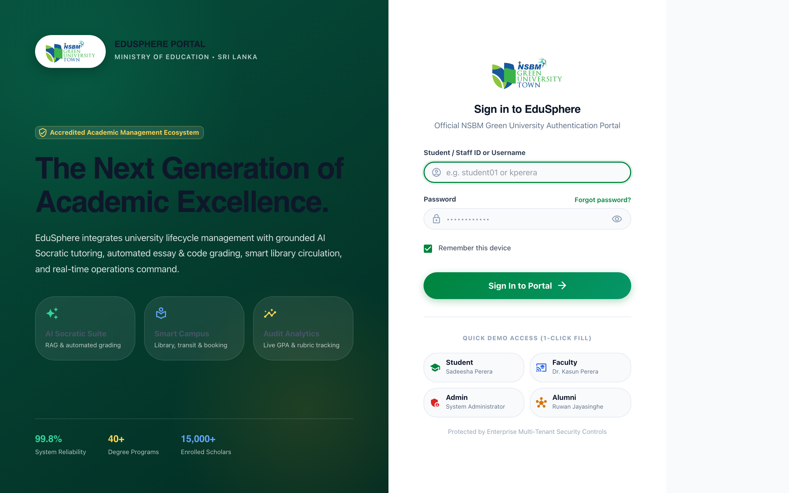
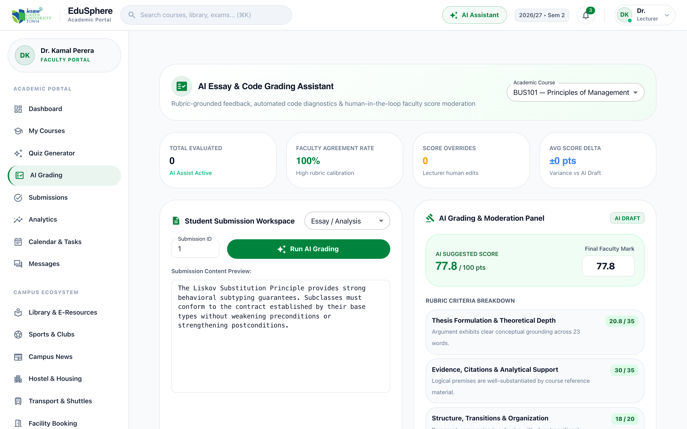
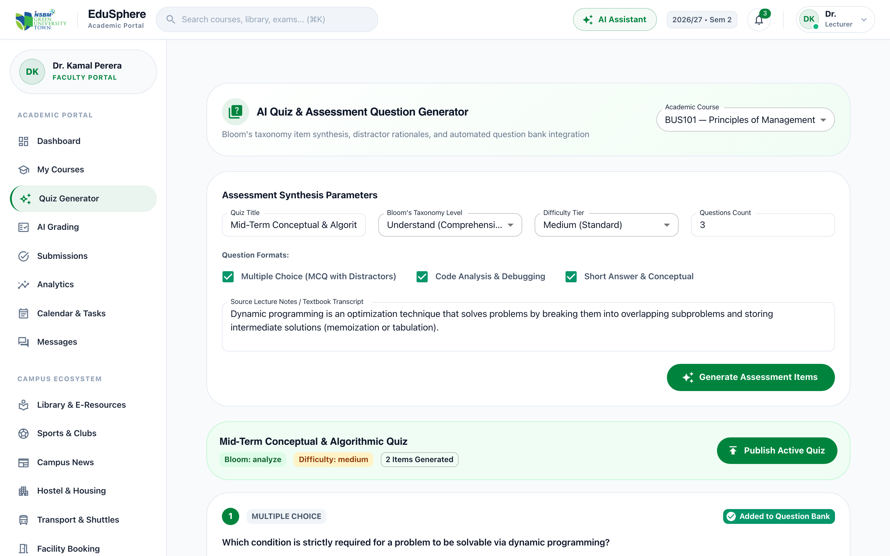
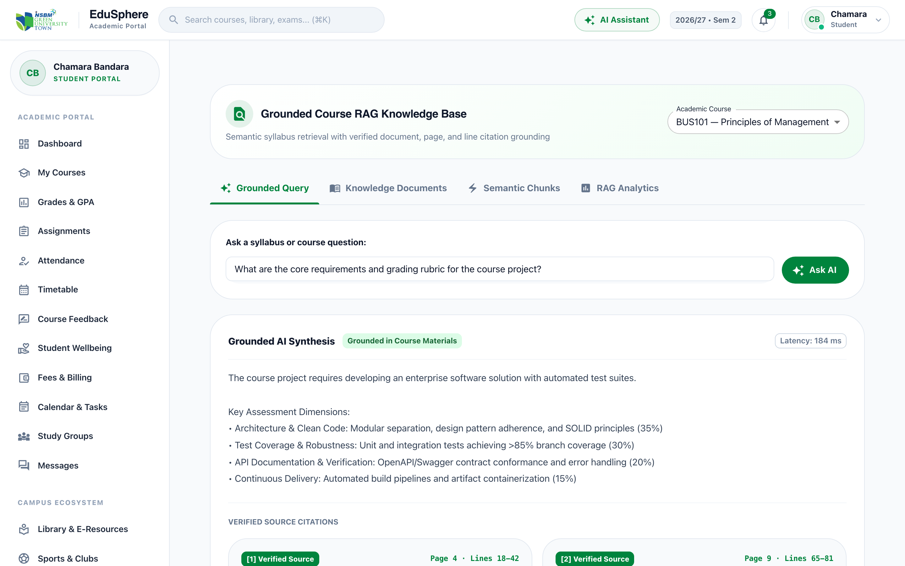
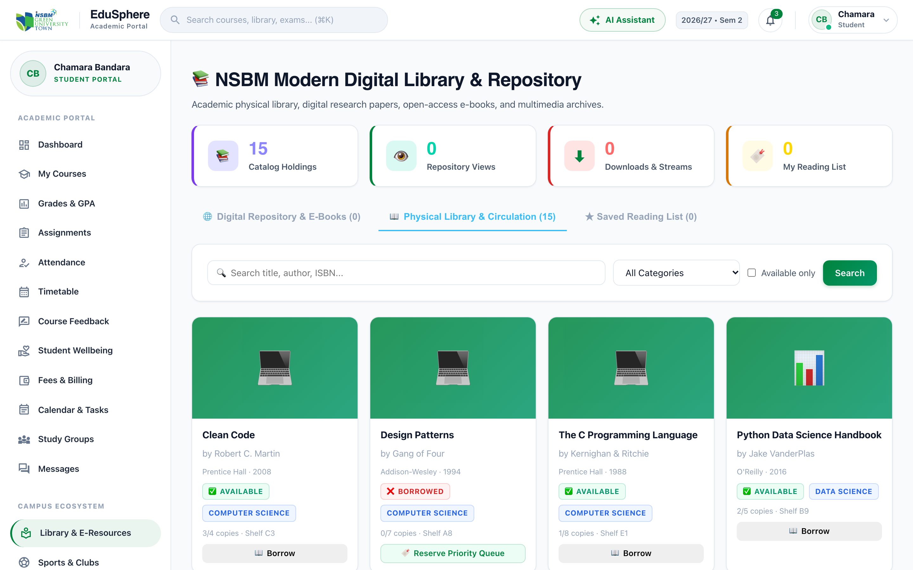
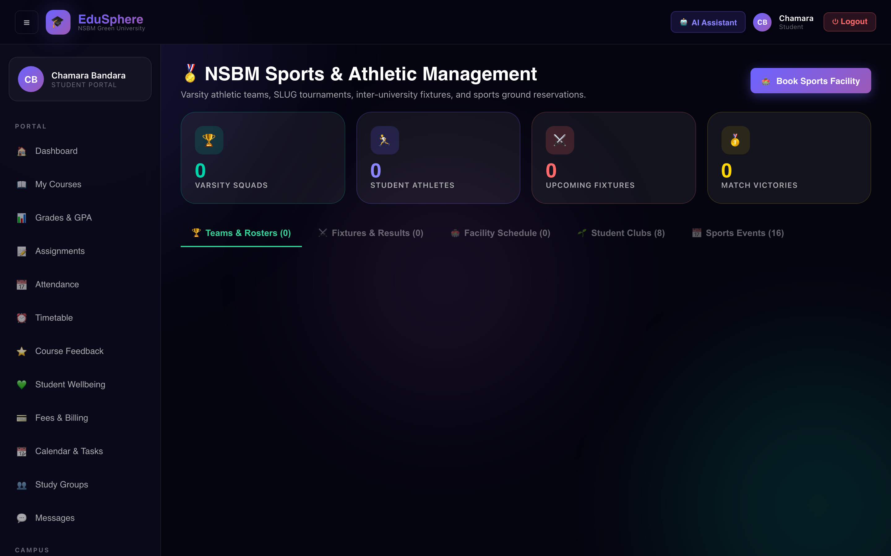

<div align="center">
  
  <h1>NSBM EduSphere — Advanced Student Management System</h1>
  <p><strong>Official Intelligent University Portal for NSBM Green University Town</strong></p>
  <p><em>Clean Modern White Theme · Material UI (MUI) · Python FastAPI · Gemini AI RAG · MCP Tools</em></p>
</div>

An enterprise-grade, production-level Student Management System engineered with a **Python FastAPI** backend, **Async SQLAlchemy** ORM, **ChromaDB + Gemini AI** (Grounded RAG + Model Context Protocol tools), and a **React 19 + TypeScript + Vite + Material UI (MUI)** frontend styled in the official NSBM Green University Town light/white theme featuring the university logo across all views.

---

## 🏛️ Official NSBM University Identity & Application Previews

The portal is styled with the authentic **NSBM Green University Town** crest, shield emblem, and brand identity, rendered in an advanced, production-level light theme using Google Material UI components.

---

### 🔐 1. Authentication & Student Portal
| NSBM Authentication Portal | Personalized Student Dashboard |
| :---: | :---: |
|  |  |
| *Official NSBM login interface with dual brand crest presentation, quick-fill demo access, and multi-role routing.* | *Live student academic hub featuring the NSBM navbar crest, real-time GPA tracker, course schedules, and quick actions.* |

---

### 🤖 2. AI-Powered Academic Intelligence Suite
| Automated Essay & Code Grading Assistant | AI Quiz & Assessment Question Generator |
| :---: | :---: |
|  |  |
| *Rubric-grounded evaluation engine with itemized criteria scoring, code complexity profiling, and faculty override moderation.* | *Bloom's taxonomy question synthesis across difficulty tiers with distractor rationales and question bank export.* |

| Grounded Course RAG Knowledge Base | Socratic AI Teaching Assistant |
| :---: | :---: |
|  |  |
| *Semantic syllabus and slide retrieval with verified page and line citations grounded in official course literature.* | *Conversational Socratic tutor providing pedagogical guidance and step-by-step hints without revealing solutions.* |

---

### ⚙️ 3. Extensibility & Operations Command
| Model Context Protocol (MCP) Console | Campus Operations Command Center |
| :---: | :---: |
|  |  |
| *Standardized MCP tool execution testbed for live grade checks, library queries, and timetable lookups.* | *Unified telemetry command center for student accommodation, transport shuttle fleet, and facilities booking.* |

---

### 📚 4. Campus Ecosystem & Student Life
| Modern Digital & Physical Library System | Sports, Athletics & Campus Clubs |
| :---: | :---: |
|  |  |
| *Catalog holdings discovery, circulation tracking, borrow status chips, and priority reservation queues.* | *Campus athletic fixtures, club registrations, facility reservations, and tournament scheduling.* |

---

## 🌟 Key Features

### ⚖️ Automated Essay & Code Grading Assistant (Latest)
- **Multi-Modal Evaluation Engine**: Evaluates both analytical essays and code implementations against predefined academic rubrics.
- **Rubric Criterion Breakdown**: Generates itemized scores across dimensions (Logic & Correctness, Architecture & Contract Compliance, Edge Cases, Code Style).
- **Confidence Scoring & Flagging**: Evaluates AI confidence levels and automatically flags borderline submissions for mandatory human review.
- **Human-in-the-Loop Moderation**: Allows course lecturers to review AI suggestions, adjust grades, add customized feedback, and approve final submissions.
- **Grading Audit Trail & Metrics**: Aggregates course-level statistics, lecturer override counts, and average score deltas for academic integrity.

### 🤖 Full-Stack AI Academic Suite
- **Grounded Course RAG (Retrieval-Augmented Generation)**: Vector knowledge base using ChromaDB and Google Gemini embeddings with automatic mock fallback.
- **Socratic AI Teaching Assistant**: Conversational tutor designed to guide students with probing questions and hints.
- **AI Quiz & Question Generator**: Synthesizes multiple-choice questions, code challenges, and conceptual prompts with instant answer explanations.
- **MCP (Model Context Protocol) Server**: Integrated agent tool execution for grade checks, library catalog searches, course schedules, and GPA calculation.

### 🏛️ Dedicated Portals & Campus Operations
1. **Student Portal**:
   - Live GPA tracker & graphical grade distribution
   - Course enrollments & semester schedule
   - Assignment tracker with direct submission modals
   - Real-time attendance monitoring with 80% threshold warnings
   - Exam & weekly timetable views
2. **Lecturer Portal**:
   - Course assignment & student roster management
   - AI-assisted grading center with human moderation
   - Submission grading center with granular rubric feedback
   - Comprehensive performance analytics & score distributions
3. **Campus Operations**:
   - **Hostel & Housing Management**: Room allocations, resident records, and maintenance requests.
   - **Transport & Shuttles**: Route mapping, stop schedules, and vehicle fleet tracking.
   - **Facility Booking**: Classroom, lab, and hall reservation workflows with conflict resolution.
4. **Digital Library**:
   - Searchable book catalog with multi-category filtering
   - Live borrowing, reservations, and fine calculations
5. **Sports & Athletic Clubs**:
   - Club discovery with category tags & membership limits
   - Upcoming campus sports & cultural events with 1-click registration
6. **Alumni Network & Hub**:
   - Global alumni directory with search & industry filters
   - Alumni experiences feed with likes and interactive tags
   - Mentorship connection request system
7. **Administration Panel**:
   - System-wide statistics & KPI metric tracking
   - Full user management (Student, Lecturer, Alumni, Admin) with instant enable/disable

---

## 🔐 Demo Credentials

| Role | Username | Password | Notes |
| :--- | :--- | :--- | :--- |
| **Admin** | `admin` | `Admin@123` | Full administrative control & campus operations |
| **Student** | `student01` | `Student@123` | CS 2nd Year Student (Sadeesha Perera) |
| **Lecturer** | `kperera` | `Lecturer@123` | Senior Lecturer (Dr. Kasun Perera) |
| **Alumni** | `alumni01` | `Alumni@123` | Tech Lead @ WSO2 (Ruwan Jayasinghe) |

---

## 🚀 Getting Started

### 1. Unified Single-Server Mode (Recommended)
```bash
./run.sh
```
Opens the app on `http://localhost:8000` (FastAPI serves both API and the pre-built React SPA).

### 2. Full Development Mode (Hot-Reloading Frontend & Backend)
```bash
./run.sh dev
```
- **React Frontend (Vite)**: `http://localhost:5173`
- **FastAPI Backend**: `http://localhost:8000`
- **Swagger Interactive API Docs**: `http://localhost:8000/docs`

---

## 🧪 Testing & Verification

The test suite covers unit and integration tests across all modules (136 tests):

```bash
./venv/bin/pytest
```

```
======================= 136 passed in 183s =======================
```

---

## 🛠️ Technology Stack

- **Backend**: Python 3.11+, FastAPI, Async SQLAlchemy, SQLite / PostgreSQL, Pydantic v2, Python-Jose (JWT), Passlib (Bcrypt), WebSockets
- **AI & RAG**: Google GenAI SDK (Gemini 2.0 Flash), ChromaDB, LangChain, Custom MCP Server
- **Frontend**: React 19, TypeScript, Vite, Material UI (MUI v6/v7), Emotion, React Router v7, Axios, Chart.js / React-ChartJS-2, React Hot Toast, Modern NSBM White Theme Design System
- **Testing**: Pytest, Pytest-Asyncio, AnyIO, HTTPX
